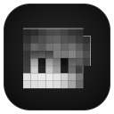

<p align="center"></p>

<h1 align="center">JellyFace</h1>

<p align="center">
  <b>A frosted-glass desktop shell for COSMIC on Pop!_OS</b><br>
  Bar · dashboard · dock · full-screen app grid · lock screen · notifications · clipboard history, on top of the COSMIC desktop you already have.
</p>

<p align="center">
  
  
  
</p>

---

JellyFace turns a stock COSMIC session into a polished, Hyprland-style desktop without replacing COSMIC. The COSMIC
compositor, settings, apps and login stay in charge; JellyFace adds its own shell on top, built with
[Quickshell](https://quickshell.org) and running from a small Arch Linux container. Every change it makes to your
COSMIC settings is recorded and can be undone with one command.

## Contents

- [Features](#features)
- [Requirements](#requirements)
- [Installation](#installation)
- [Everyday use](#everyday-use)
- [Lock screen and idle behaviour](#lock-screen-and-idle-behaviour)
- [Configuration](#configuration)
- [Staying compatible with Pop!_OS and COSMIC updates](#staying-compatible-with-pop_os-and-cosmic-updates)
- [Reliability and safety](#reliability-and-safety)
- [Troubleshooting](#troubleshooting)
- [Command reference](#command-reference)
- [Uninstall](#uninstall)
- [Project layout](#project-layout)
- [Licence and credits](#licence-and-credits)

## Features

| | |
|---|---|
| **Bar** | Slim left bar: JellyFace logo, real COSMIC workspaces, the focused app's name, tray, status icons (Wi-Fi, Bluetooth, sound, battery), clock, power menu. Hides automatically for a fullscreen window on the current workspace. |
| **Dashboard** | Slides down from the top edge: calendar, weather, media player with lyrics, performance gauges, quick actions (screenshot, record, clipboard, focus mode, keep awake). |
| **Dock** | Frosted-glass capsule of app pills with monochrome symbols; shows running and focused apps, reorders by drag, has right-click menus and web apps. Slides away when a window overlaps it; push the cursor to the bottom edge to call it back. |
| **Dynamic Island** | Pill at the top centre showing the clock, or the playing media (live equaliser); hover or click to expand into a card with artwork, scrubber and transport controls. Tucks away while the dashboard or JellyPanel is open and for fullscreen windows. |
| **JellyPanel** | Press **Super** for a full-screen, Launchpad-style grid of every installed app (pages of 7 x 5, type to search). Opens in about 10 ms. |
| **Launcher** | Hover the bar logo for a searchable app list with calculator and actions. |
| **Lock screen** | Clock, weather, media, system gauges and a password box checked against your real login password. Locks after 3 idle minutes or with **Super+L**; the screen never goes black while locked. |
| **Notifications** | Own pop-ups and notification centre, Do Not Disturb, and **focus mode** (**Super+Shift+F**) that also keeps the screen awake. |
| **Clipboard history** | **Super+V**: searchable text and image history with pinning; content marked sensitive by password managers is never stored. |
| **Agenda card** | Desktop card with your next events from Google Calendar (private iCal address) or any `.ics` file. |
| **Frosted glass** | Five neutral glass tiers over COSMIC's blur that adapt to the wallpaper's brightness, or wallpaper-matched colour palettes from `Color_Palette/` (`jellyface glass off`). |
| **COSMIC integration** | systemd user service, a native COSMIC panel applet, COSMIC custom shortcuts, optional theming of COSMIC's own apps, and an optional matching login screen. |

## Requirements

- **Pop!_OS 24.04 LTS with the COSMIC desktop** (tested on COSMIC 1.10), logged in to a COSMIC Wayland session
- About **8 GB** of free disk space during installation (the container is about 6 GB; build caches about 2 GB, which can be deleted afterwards)
- An internet connection for the first installation
- Host packages:

```bash
sudo apt install distrobox podman flatpak build-essential libwayland-dev libwayland-bin python3-gi gir1.2-gdkpixbuf-2.0
```

Nothing else is installed system-wide. The Rust toolchain used to build the COSMIC applet goes into the project folder
(`.rust/`) and no `sudo` is used on the host, except for the optional [login screen](#optional-login-screen).

## Installation

```bash
git clone https://github.com/bhanot-99/JellyFace ~/JellyFace
cd ~/JellyFace
bin/jellyface install                                  # container, packages, build, default config
ln -s ~/JellyFace/bin/jellyface ~/.local/bin/jellyface # `jellyface` from anywhere (assumed below)
```

`install` is safe to run again. It:

1. Creates an Arch Linux **distrobox container** (`jellyface`; set `JF_CONTAINER` in `.env.local` to change it), installs
   Quickshell, Qt 6 and the other dependencies inside it, and **pins Qt and Quickshell** so later container upgrades
   can't break the shell.
2. Builds the two small C helpers (COSMIC workspaces and windows), the shell's native plugin, the COSMIC theme tool and
   the native panel applet. `JF_SKIP_RUST=1` skips the two Rust parts.
3. Installs the default configuration (your existing settings are kept) and **Kooha** for screen recording.

Then try it, check it, and make it part of your session:

```bash
jellyface start --timeout 120   # safe first run: stops by itself after 2 minutes
jellyface doctor                # checks every part, including the lock-screen safety net
jellyface integrate             # shows a plan, asks, then wires JellyFace into the COSMIC session
```

`integrate` sets up the following, all inside your own account:

| What | Details |
|---|---|
| Starts with the session | systemd user service (`jellyface service on\|off\|status`); restarts on failure, gives up after 5 failures in 5 minutes. |
| COSMIC tweaks | COSMIC's top panel auto-hides; screen-off and idle suspend set to *never* (see [lock screen](#lock-screen-and-idle-behaviour)); shortcuts **Super** (JellyPanel), **Super+L** (lock), **Super+V** (clipboard), **Super+Shift+F** (focus mode). Shortcuts you already have are kept. |
| Native applet | A JellyFace button in COSMIC's own panel (`jellyface applet install`, `applet panel-add`). |
| COSMIC theming | Optional: COSMIC's own apps follow JellyFace's colours (`jellyface theme system on\|off`). |

### Optional: login screen

`jellyface greeter` can make JellyFace's lock-screen look your login screen as well. It needs `sudo` and changes system
files, so it is never part of `install` or `integrate`. It fails safe: if it ever fails to start, COSMIC's stock login
screen appears instead and a healer service repairs or disables it.

```bash
jellyface greeter test | window | export | install | status | uninstall
```

## Everyday use

| Do this | To get this |
|---|---|
| **Super** | JellyPanel: every app in a full-screen grid (type to search, arrows + Enter, scroll for pages, Escape closes) |
| Hover the **JellyFace logo** in the bar | App launcher |
| Move the cursor to the **top edge** | Dashboard (Dashboard, Media, Performance, Weather tabs) |
| Move the cursor to the **bottom edge** | Bring the dock back over windows |
| Click a **workspace number** | Switch COSMIC workspace |
| Click the **clock, Wi-Fi, Bluetooth, sound** icons | Their pop-outs |
| Click the **bell** / **power** icon | Notification centre / session menu |
| **Super+L** | Lock the screen |
| **Super+V** | Clipboard history |
| **Super+Shift+F** | Focus mode (Do Not Disturb + screen kept awake) |
| Click outside a panel or press **Escape** | Close it |

Everything can also be scripted, for example from COSMIC custom shortcuts:

```bash
jellyface ipc drawers toggle dashboard     # also: launcher, sidebar, session, utilities
jellyface ipc drawers dashboardTab 1       # 0 Dashboard, 1 Media, 2 Performance, 3 Weather
jellyface ipc jellypanel toggle
jellyface lock
```

**Dock.** Click an app to open it, or to focus and cycle its windows when it is running. Drag to reorder; right-click an app
for its menu, or the dock to add apps and web apps. A custom symbol: `"symbol": "<Material Symbols name>"` on the app in
`~/.config/jellyface/dock.json`.

**Agenda.** Google Calendar on the web -> Settings -> your calendar -> *Integrate calendar* -> **Secret address in iCal
format**, then `jellyface agenda set "<address>"` (keep the address private). A local `.ics` path works too.

## Lock screen and idle behaviour

- After **3 minutes** without input (or **Super+L**), JellyFace's lock screen appears and **stays on screen**:
  COSMIC's screen-off and idle-suspend timers are set to *never* by `jellyface cosmic-tweaks`, so the display doesn't go
  black while locked. Closing the lid and the power menu still suspend as usual.
- The password is checked against your **real host login password** (the container's own account has none);
  the check fails closed, and `jellyface doctor` verifies that a wrong password is rejected.
- **Safety net.** If the shell ever stops or crashes while the screen is locked, COSMIC's own lock screen takes over
  at once, so you're never left with a locked desktop and nothing to type your password into. `jellyface stop` and
  `restart` refuse to run while the screen is locked.
- To change the idle time, edit `general.idle.timeouts` in `~/.config/jellyface/shell.json` (seconds), then
  `jellyface restart`.
- Prefer to save power on battery? `jellyface cosmic-tweaks --revert` restores COSMIC's own timers; the screen then
  turns off after COSMIC's delay as before.

## Configuration

| File | Controls |
|---|---|
| `~/.config/jellyface/shell.json` | Behaviour: bar entries, idle/lock timeouts, weather location and unit, rounding |
| `~/.config/jellyface/shell-tokens.json` | Sizes of the dashboard, cards and components |
| `~/.config/jellyface/dock.json` | Dock apps |
| `~/.config/jellyface/desktop.json` | Agenda card (`"enabled": false` hides it) |
| `~/.local/state/jellyface/scheme.json` | Colours (written automatically) |
| `config/icon-aliases.txt` | Tray icons that ask for a name nobody ships (`jellyface fix-icons` applies them) |

Defaults live in `config/`. A broken file never keeps JellyFace from starting: it's backed up and the default is used.

```jsonc
// ~/.config/jellyface/shell.json: weather location (a city or "lat,lon") and unit
{ "services": { "weatherLocation": "30.70547,76.22196", "weatherUnits": "Celsius" } }
```

**Look.** `jellyface glass on|off` switches between frosted glass (default) and wallpaper-matched palettes.
With palettes: `jellyface theme match|apply [N]|tint 0-6|soft 0-2|auto on|off|list|status`.

## Staying compatible with Pop!_OS and COSMIC updates

JellyFace is designed so that system updates don't break it:

- **It doesn't replace any part of COSMIC.** It talks to the compositor only through standard or stable Wayland
  protocols (layer-shell, session-lock, ext-workspace, ext-foreign-toplevel-list, cosmic-toplevel-info), binding the
  protocol versions it knows, which newer compositors keep supporting.
- **Its own userland is frozen.** Quickshell and Qt live in the container, are pinned there, and are untouched by `apt`
  or COSMIC updates. Pop!_OS updates never upgrade distrobox containers.
- **It degrades instead of breaking.** If an update ever drops a protocol, the matching helper stops and is retried
  with a growing delay (up to once a minute); the rest of the shell keeps working. If the shell can't start at all, the
  service gives up after 5 tries and you have plain COSMIC.
- **One command checks everything** after an update: `jellyface doctor`.
- **NVIDIA driver updates:** reboot before using the desktop again. `doctor` warns about a driver/module mismatch.

If you ever want newer Quickshell/Qt in the container: comment out the `IgnorePkg` line in the container's
`/etc/pacman.conf`, upgrade, then run `jellyface build`.

## Reliability and safety

- A **supervisor** restarts the shell after a crash (with back-off; gives up after 5 immediate crashes) and allows only
  one instance.
- **Every change outside `~/JellyFace` is tracked** with a copy of the original in `backups/`;
  `jellyface revert-system` restores everything (`--list` shows what). Backups are never deleted automatically.
- Logs: `logs/jellyface.log` (rotated at 5 MB), `logs/theme.log`, `journalctl --user -u jellyface`.
- `tests/stability.sh` (about 5 minutes, `--quick` for 1) checks start, double start, crash recovery, helper respawn,
  stop/start cycles, invalid config, a cold container, 125 drawer toggles and memory growth. It stops the service
  while it runs, so run it while you're at the computer.

## Troubleshooting

| Problem | Fix |
|---|---|
| Something looks wrong | `jellyface doctor`, then `jellyface status`; logs as above |
| JellyFace is hidden | A window on the current workspace is fullscreen; leave fullscreen or switch workspace |
| Panel applet not visible | COSMIC's panel auto-hides: move the cursor to the top edge |
| Stuck at a locked screen | Shouldn't happen (see the safety net). If it does: `Ctrl+Alt+F3`, log in, run `jellyface ipc lock unlock` or `loginctl unlock-sessions` |
| Grey or frozen screen after an NVIDIA update | Reboot; check `nvidia-smi` for "API mismatch" |
| Weather shows `--` | The weather service was unreachable; it retries by itself |
| Rebuild from scratch | `jellyface build` (recreates the build caches) |
| Editing the QML | `JF_DEV=1 jellyface start` enables live reload |

## Command reference

```
jellyface install | build | doctor | help
jellyface start [--timeout N] [--foreground] | stop | restart | status
jellyface service on|off|status          start with the COSMIC session (systemd user service)
jellyface integrate [--yes]              service + tweaks + applet + theming, after a confirmation
jellyface revert-system [--list]         undo every change made outside ~/JellyFace
jellyface cosmic-tweaks [--revert]       panel auto-hide, always-on lock screen, shortcuts
jellyface applet install|panel-add|panel-remove|remove
jellyface glass on|off                   frosted glass or wallpaper palettes
jellyface theme apply|match|list|tint|soft|system|auto|status
jellyface lock                           lock the screen
jellyface agenda set <ics|url> | status
jellyface focus|tiling on|off|status     COSMIC focus-follows-cursor / auto-tiling
jellyface cosmic-dock hide|show|status   COSMIC's own dock
jellyface greeter test|window|export|install|uninstall|status
jellyface fix-icons | notify SUMMARY [BODY] | ipc <target> <function> [args]
jellyface pop-all [seconds]              show every panel and popout at once (for screenshots and testing)
jellyface demo-island [--auto]           interactive Dynamic Island demo
jellyface mail [refresh|status|set-account <address>|set-password]   optional Gmail (IMAP app password) sync
```

## Uninstall

```bash
jellyface greeter uninstall      # only if you installed the login screen
jellyface revert-system          # restores your COSMIC settings; removes the service, applet and theme files
distrobox rm --force jellyface   # the container (its name is in .env.local)
rm -rf ~/JellyFace               # copy backups/ somewhere first if you want to keep them
```

## Project layout

```
bin/jellyface        command line          shell/      the Quickshell shell (QML + C++ plugin)
scripts/             install, build, supervisor, theming, COSMIC tweaks, revert
helpers/             C helpers for COSMIC workspaces and windows
native/              native COSMIC panel applet (Rust)     tools/  COSMIC theme writer (Rust)
greeter/             optional login screen                  config/ defaults
tests/               stability suite                        docs/   architecture notes
```

See [docs/ARCHITECTURE.md](docs/ARCHITECTURE.md) for how the pieces fit together, [CHANGELOG.md](CHANGELOG.md) for
release notes and [SECURITY.md](SECURITY.md) for how the lock screen and password checking work.

## Licence and credits

- JellyFace's own code (everything outside `shell/`) is released under the **MIT licence**, see [LICENSE](LICENSE).
- `shell/` is derived from the [caelestia-dots shell](https://github.com/caelestia-dots/shell) and therefore stays under
  the **GNU GPL v3**, see [shell/LICENSE](shell/LICENSE) (upstream commit in `shell/UPSTREAM`). If you distribute
  JellyFace, the GPL applies to that part.
- Built on [Quickshell](https://quickshell.org), [COSMIC](https://github.com/pop-os/cosmic-epoch) and
  [distrobox](https://distrobox.it). Material Symbols by Google.
